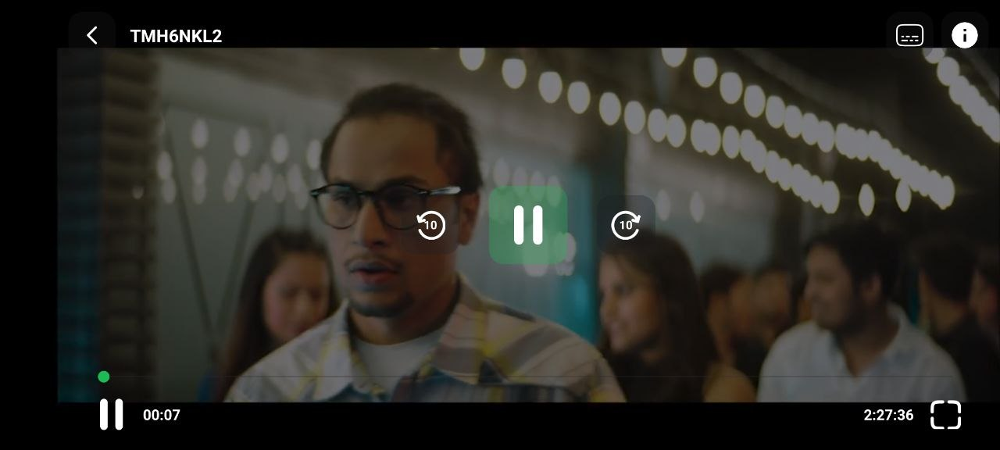
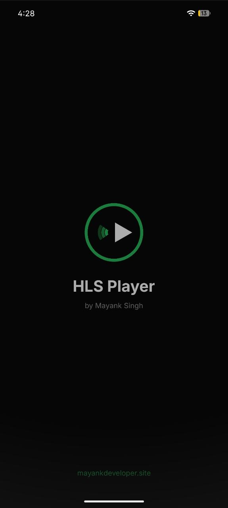
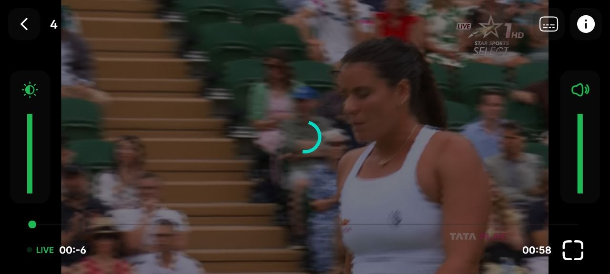
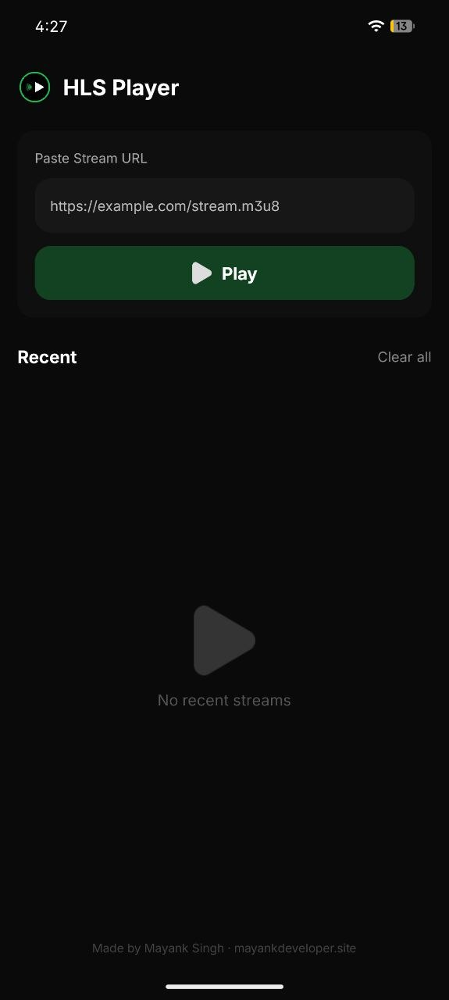
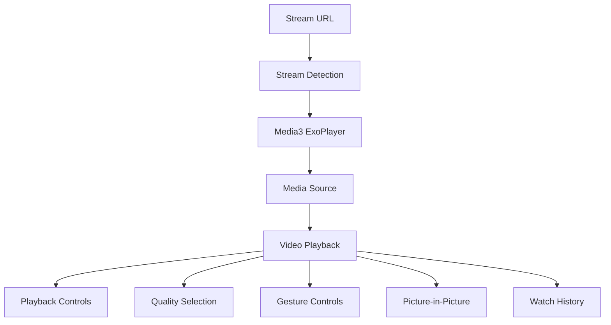

# 📺 Android HLS Player

<h3 align="center">A Feature-Rich Android Streaming Player</h3>

<p align="center">
  A lightweight, modern HLS/M3U8 video player built with Android Media3 ExoPlayer, featuring adaptive quality selection, gesture controls, live streaming, and Picture-in-Picture support.
</p>

<p align="center">
  
  
  
  
  
</p>

<p align="center">
  <a href="#-features">Features</a> ·
  <a href="#-screenshots">Screenshots</a> ·
  <a href="#-download">Download</a> ·
  <a href="#-installation">Installation</a> ·
  <a href="#-technology-stack">Tech Stack</a>
</p>

---

## 🚀 Overview

Android HLS Player is a lightweight yet feature-rich video streaming application designed to play HLS/M3U8 streams, MP4 files, and direct video URLs.

Powered by Google's Android Media3 ExoPlayer, it provides a smooth playback experience with adaptive streaming, manual quality selection, gesture-based controls, and multitasking support.

The application focuses on performance, usability, and a clean Android video playback experience.

---

## ✨ Features

### 🎬 Multi-Format Playback

- HLS / M3U8 streaming.
- MP4 video playback.
- Direct video stream URLs.
- Media3 ExoPlayer playback engine.

### 📶 Adaptive Quality Selection

- Automatic adaptive bitrate selection.
- Manual resolution selection.
- Supports available stream qualities such as 1080p, 720p and 480p.
- Quality switching during playback.

### 🔴 Live Streaming

- Live stream detection.
- Animated LIVE indicator.
- Optimized controls for live playback.

### 🌟 Gesture-Based Controls

- Swipe gestures for brightness adjustment.
- Swipe gestures for volume adjustment.
- Intuitive playback interaction.
- Visual feedback during adjustments.

### 🕐 Watch History

- Recently played stream URLs.
- Playback progress tracking.
- Quick access to previous streams.

### 📱 Picture-in-Picture

- Android Picture-in-Picture support.
- Continue playback while using other applications.
- Multitasking-friendly playback experience.

### ⏩ Playback Controls

- 10-second forward seeking.
- 10-second backward seeking.
- Visual seek feedback.
- Playback progress controls.

---

## 📸 Screenshots

<p align="center">
  
  
  
  
</p>

---

## 📲 Download

<p align="center">
  <a href="assets/hlsplayer-debug.apk">
    
  </a>
</p>

<p align="center">
  <b>Minimum Android Version:</b> Android 7.0 (API 24)
</p>

Download the APK directly from the repository and install it on a compatible Android device.

For source builds, follow the installation instructions below.

---

## 🛠️ Technology Stack

### Android Development

<p>
  
</p>

### Media & Playback

- AndroidX Media3 ExoPlayer
- HLS Media Source
- Adaptive Bitrate Streaming
- Picture-in-Picture API

### UI & Application Components

- Material Components
- Native Android UI
- Gesture Recognition
- Android Media APIs

---

## 🏗️ Playback Architecture



---

## 📂 Project Structure

```text
android-hls-player/
│
├── app/
│   ├── src/
│   │   └── main/
│   │       ├── java/
│   │       ├── res/
│   │       └── AndroidManifest.xml
│   │
│   └── build.gradle
│
├── assets/
│   ├── ss1.jpg
│   ├── ss2.jpg
│   ├── ss3.jpg
│   ├── ss4.jpg
│   └── hlsplayer-debug.apk
│
├── build.gradle
├── settings.gradle
└── README.md
```

This is a representative structure; actual folders may vary with the repository layout.

---

## ⚙️ Requirements

- Android Studio Hedgehog or newer.
- Android SDK 24 or newer.
- Kotlin and Java development support.
- Gradle build environment.

---

## 🚀 Installation & Build

### 1. Clone Repository

```bash
git clone https://github.com/mynkdev-21/android-hls-player.git

cd android-hls-player
```

### 2. Open in Android Studio

Open the project directory in Android Studio.

### 3. Gradle Sync

Allow Android Studio to download and configure the required Gradle dependencies.

### 4. Run Application

Connect an Android device or launch an emulator and click **Run**.

---

## 🎥 Supported Stream Types

| Format | Support |
|---|---|
| HLS / M3U8 | ✅ |
| MP4 | ✅ |
| Direct Stream URLs | ✅ |
| Adaptive Bitrate Streaming | ✅ |
| Live HLS Streams | ✅ |

Playback compatibility depends on the stream's encoding, network availability, and server configuration.

---

## 🔮 Future Improvements

- [ ] Subtitle selection and customization.
- [ ] Playback speed control.
- [ ] External subtitle support.
- [ ] Chromecast integration.
- [ ] Advanced buffering controls.
- [ ] Audio track selection.
- [ ] Enhanced playback statistics.

---

## 📄 License

Distributed under the MIT License.

Free to use, modify, and distribute under the terms of the license.

---

## 📬 Contact & Connect

Have a question, suggestion, or collaboration idea? Feel free to connect.

<p align="center">
  <a href="mailto:mayanksingh3132@gmail.com">
    
  </a>
  <a href="https://linkedin.com/in/mynk-dev">
    
  </a>
  <a href="https://t.me/mayankdeveloper">
    
  </a>
  <a href="https://github.com/mynkdev-21">
    
  </a>
</p>

| Platform | Link |
|---|---|
| 📧 Email | mayanksingh3132@gmail.com |
| 🌐 Portfolio | [mayankdeveloper.site](https://mayankdeveloper.site) |
| 💼 LinkedIn | [mynk-dev](https://linkedin.com/in/mynk-dev) |
| 🏢 Company | [AmTech INFO](https://amtechinfo.online) |
| ✈️ Telegram | [@mayankdeveloper](https://t.me/mayankdeveloper) |
| 🐙 GitHub | [mynkdev-21](https://github.com/mynkdev-21) |

---

<p align="center">
  <b>Built with ❤️ by Mayank Singh.</b>
  <br/>
  <sub>Android Engineering · Video Streaming · Media3 ExoPlayer</sub>
</p>
